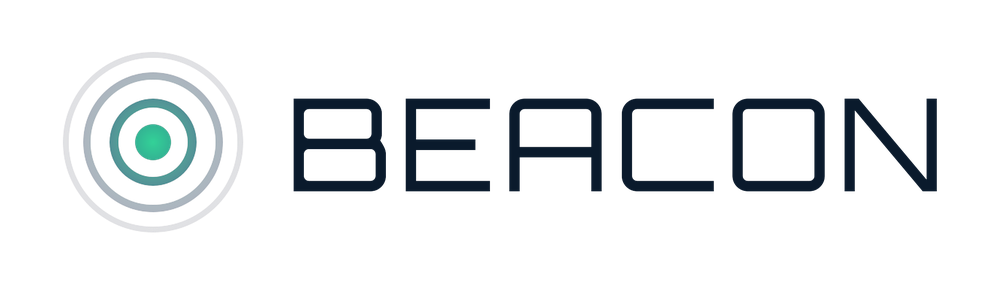
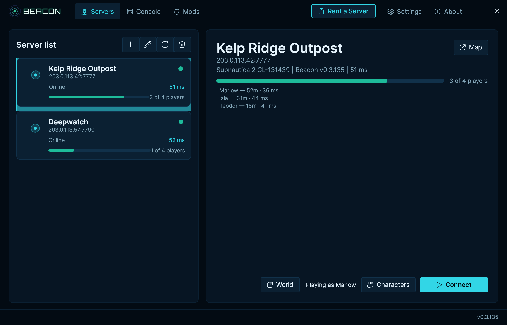
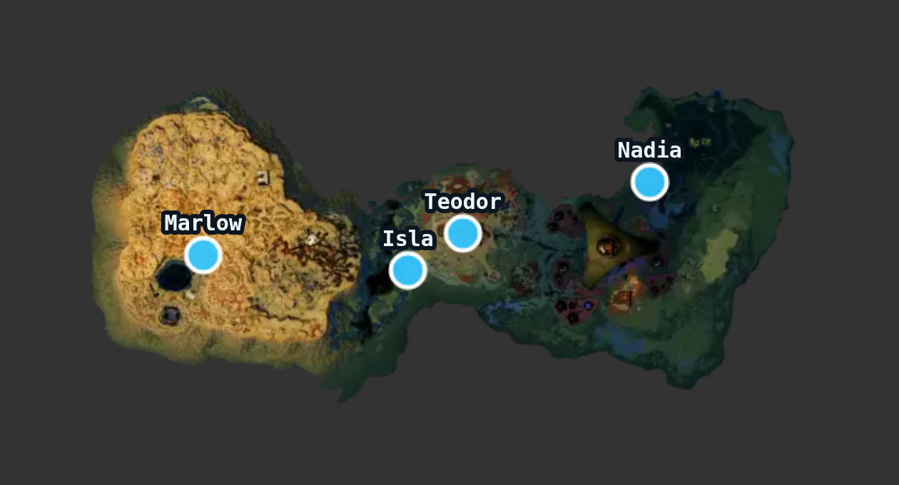
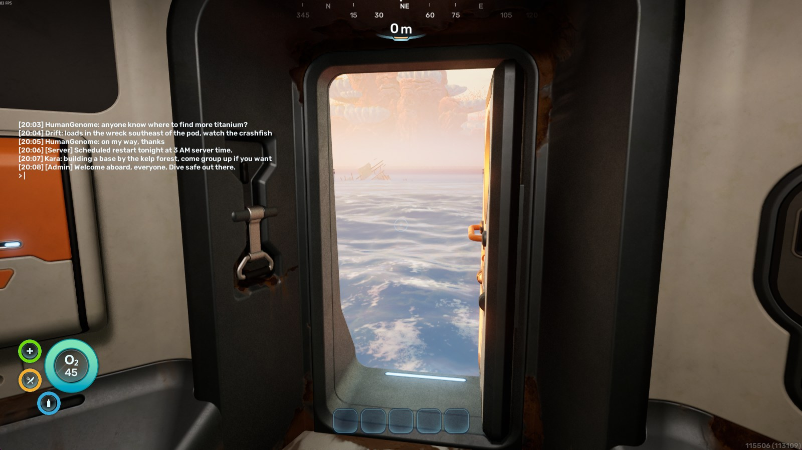
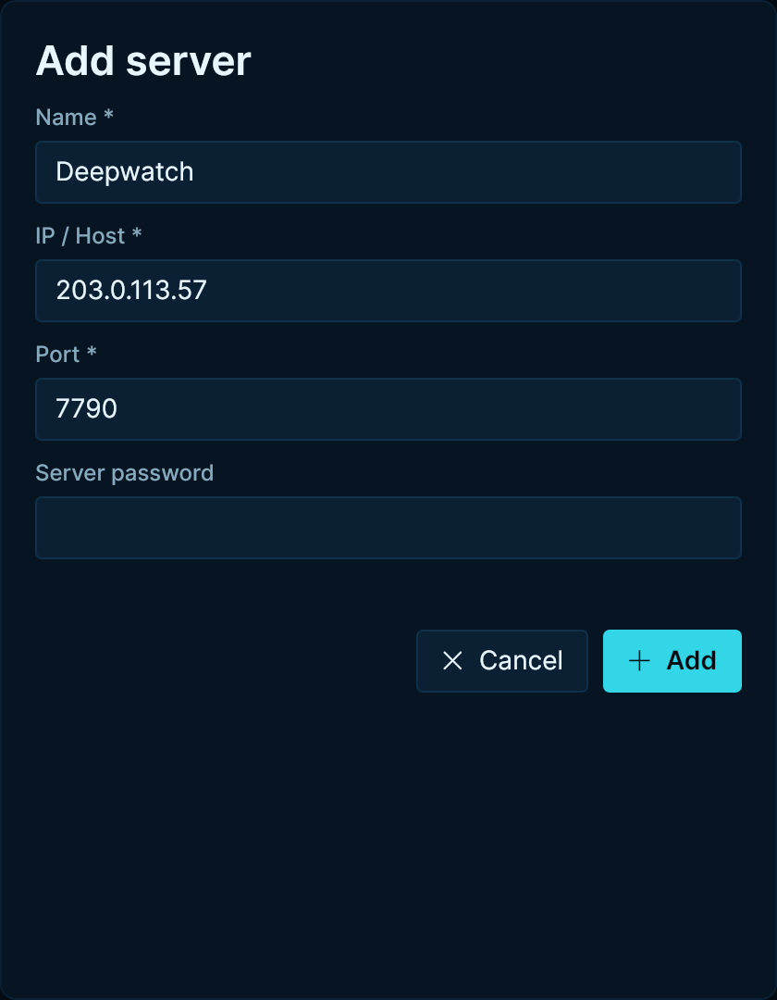
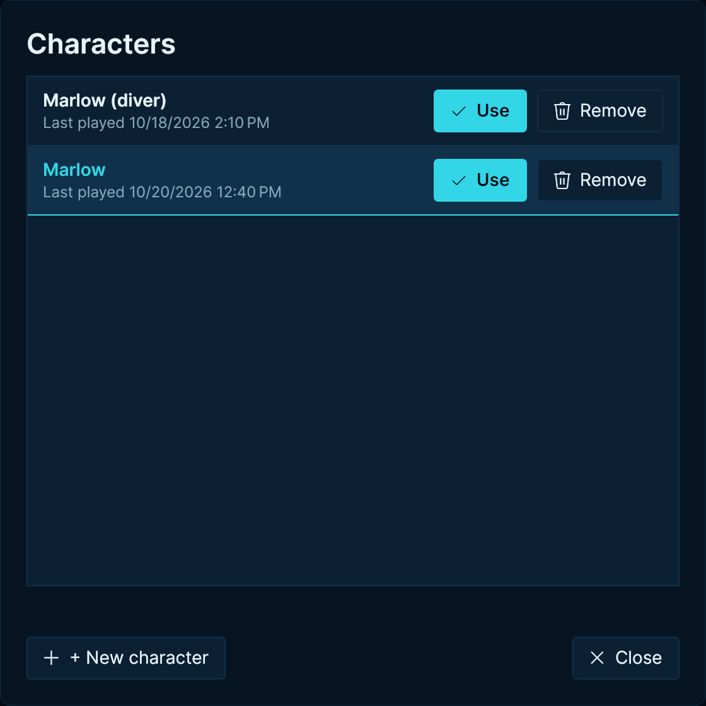
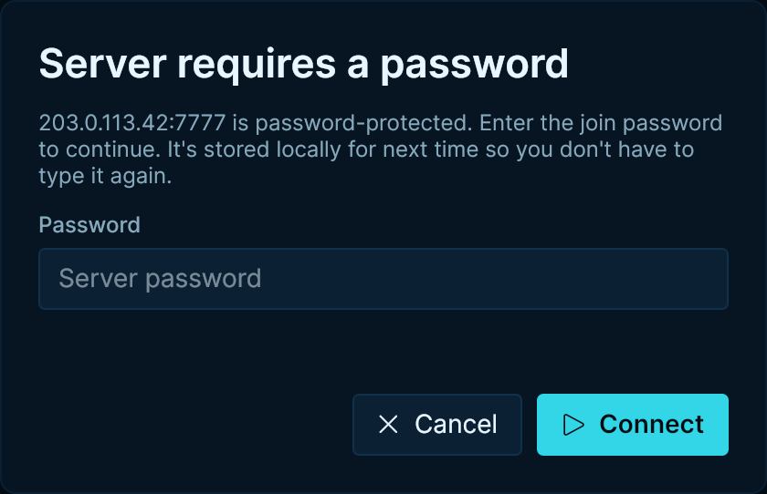
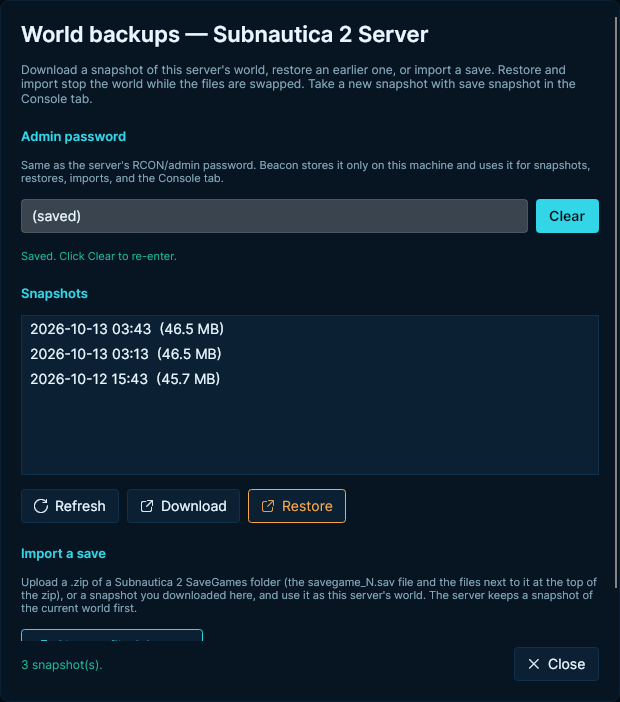
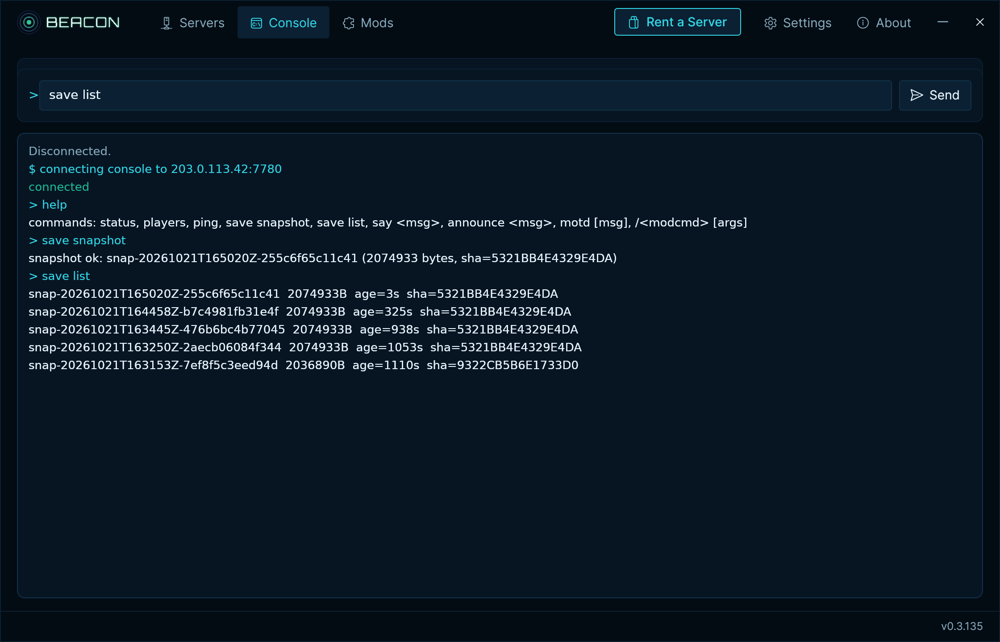
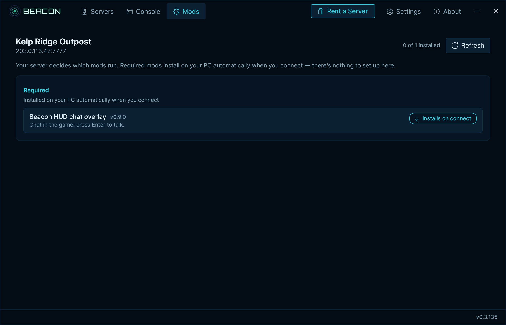

  <picture>
    <source media="(prefers-color-scheme: dark)" srcset="docs/img/beacon-logo-dark.png">
    
  </picture>

  
  
  
  

# Beacon

**Subnautica 2** has no dedicated server. Its multiplayer is a co-op session of up to four players, hosted from one player's copy of the game. Beacon adds a Subnautica 2 dedicated server. Players join it by IP with the Beacon app.

Every player needs the Beacon app to join.

  

## Features

### 🗺 Live map
See who's online on a live map of the whole Subnautica 2 world, with its points of interest. Press **Map** in the app to open it in your browser. Players on the server see where everyone is, and the server owner can make the map public.

  

### 💬 Text chat
Press Enter to chat without leaving the game. Player messages, server notices and admin announcements show in one panel, and players can type `/players` and `/help` in the chat box. Chat shows on servers that offer Beacon's chat. A server you host yourself from the BeaconServer download doesn't include it.

  

### 🧭 Join by IP
Add the server's IP and port in the app and press **Connect**. Beacon starts Subnautica 2 and joins the server. The server list shows whether each server is up, who is on it and for how long, and your ping.

  

### 🧑‍🚀 Multiple characters
Keep separate characters on each server. Beacon remembers which one you played on each server.

  

### 🔒 Password protection
Set a password on the server and the app asks for it once, then remembers it. Server lists show a lock.

  

### 💾 World backups
The app's **World** window lists the server's backups by time and size and downloads any of them. On a server you host yourself, it also restores a backup, uploads a save from your PC, and copies a world from another of your servers, each after you confirm. The server backs up the current world first, and a server you host yourself also backs up at every autosave.

  

### 🖥 Server console
Type admin commands in the app's **Console** tab, or in any RCON tool: `status`, `players`, `save snapshot`, `say`, `announce`, `motd` and the commands server mods add. `announce` posts a notice in every player's chat.

  

### 🧩 Mods
Beacon loads UE4SS mods on the server and in players' games. The app installs a server's required mods when you connect, and its **Mods** tab shows what each server needs. Server setup: [docs/MODS.md](https://github.com/HumanGenome/BeaconServer/blob/main/docs/MODS.md).

  

## Install

### Rent a server
[SurvivalServers.com](https://www.survivalservers.com/services/game_servers/subnautica_2/?utm_source=github&utm_medium=readme_install&utm_campaign=beacon) runs Subnautica 2 servers with BeaconServer installed.

### Players
1. Download `BeaconSetup-<version>.exe` from the [latest release](https://github.com/HumanGenome/Beacon/releases/latest).
2. Run it. At "Windows protected your PC" choose **More info**, then **Run anyway**.
3. Open Beacon, press **+** and enter the server's IP and port.
4. Press **Connect**. The first time, Beacon asks you to make a character for that server.

Beacon updates itself. The Nexus Mods copy doesn't: get new versions from its Files tab.

### Host your own
1. Download `Beacon-Server-Windows-x64-v<version>.zip` from the [latest BeaconServer release](https://github.com/HumanGenome/BeaconServer/releases/latest). It has everything the server needs.
2. Extract it to a stable folder, for example `C:\Beacon\`.
3. Put the Subnautica 2 game files in `C:\Beacon\game` (the `SnInstallRoot` setting): copy your `steamapps\common\Subnautica2` folder there, or install it with SteamCMD (app `1962700`).
4. Edit `BeaconServer\appsettings.json` (server name, ports, `RconPassword`).
5. Open the game and query ports (UDP) and the RCON and admin ports (TCP).
6. Run `BeaconServer\BeaconServer.exe`.

Ports, settings and console commands: [BeaconServer README](https://github.com/HumanGenome/BeaconServer).

## Releases

Each release has:

- `BeaconSetup-<version>.exe`: installer for players
- `BeaconSetup-latest.exe`: a link that always points at the newest installer
- `BeaconSetup-<version>-nexus.exe`: the Nexus Mods copy, which doesn't update itself
- `Beacon-Launcher-Windows-x64-v<version>.zip`: the app without an installer
- `checksums-launcher.txt`: hashes for the launcher assets

The server download is on the [BeaconServer release page](https://github.com/HumanGenome/BeaconServer/releases/latest).

## Source

- **Beacon** (this repo): the player app's downloads and documentation. The app is closed source.
- **[BeaconServer](https://github.com/HumanGenome/BeaconServer)**: the dedicated server. Open source, MIT.

## FAQ

### How do I join a server?
Press **+** in Beacon and enter a name, the server's IP and its port. You only enter the game port. Beacon works out the others. Select the server and press **Connect**.

### How many players can join?
The server owner sets the limit, 4 by default. Subnautica 2's own co-op is built for 4 players.

### Can I run the server on the same machine I play on?
No. The server runs its own copy of Subnautica 2, and Steam runs one copy of a game per account. Run the server on another PC and join it from yours.

### Do I need to own Subnautica 2 on the server machine?
Yes. Install Subnautica 2 on the server PC from a Steam account that owns it.

### Can I bring my own world?
Yes, on a server you host yourself. Open the server's **World** window, save its admin password, and press **Choose file** under **Upload a save**. The save is a `.zip` of a Subnautica 2 SaveGames folder, with `savegame_N.sav` at the top of the zip, not inside a folder. The server backs up the current world first, then restarts on yours. On a rented server, ask your host to load it.

### Does it change my game?
Only while you play through Beacon. Connect sets the game's network settings for a Beacon join and a 1600x900 window, in your normal Subnautica 2 config folder. When the game closes, Beacon puts your own Engine.ini and display settings back, or on its next start if the app was closed or crashed by then. A display setting you change in game during the session is kept.

### Is Linux supported?
No. Beacon runs on Windows only, for players and servers (Windows 10, 11 or Server, 64-bit).

### Why does Windows warn about the installer?
Windows shows "Windows protected your PC" for installers that are not code-signed. Choose **More info**, then **Run anyway**. You can check the file against the release's `checksums-launcher.txt`.

## Troubleshooting

- **"The game was not started via the platform launcher and will be closed."** On the server PC, keep Steam running and signed in to an account that owns Subnautica 2 (offline mode is fine), under the same Windows user as BeaconServer. BeaconServer writes `steam_appid.txt` itself.
- **Players can't join after a Subnautica 2 update.** The server and every player must be on the same game build. Update the server's game files whenever the game updates.

## Contributing

Bugs: open an [issue](https://github.com/HumanGenome/Beacon/issues) with your Beacon and BeaconServer versions, the Subnautica 2 build and the lines from the server's `logs\beacon-*.log`. Security problems go through [private reporting](https://github.com/HumanGenome/Beacon/security/advisories/new).

## Community note

Beacon is a community project and is not affiliated with or endorsed by the developers of Subnautica 2.

## License

The documentation in this repo is MIT. The app and in-game runtime binaries attached to releases are free for personal use and closed source. BeaconServer is MIT in its own repo. Full terms in [LICENSE](LICENSE).

## Credits

- [UE4SS](https://github.com/UE4SS-RE/RE-UE4SS): Unreal Engine scripting and modding framework
- [Avalonia](https://avaloniaui.net/): .NET UI framework used by Beacon
- [joric/subnautica](https://github.com/joric/subnautica) (Unlicense): the interactive Subnautica 2 map that powers Beacon's live web map
- [MultiplayerChat](https://www.nexusmods.com/subnautica2/mods/153) by TheMC ([TheMCNetwork](https://github.com/TheMCNetwork/MultiplayerChat)): first showed the approach Beacon's in-game chat uses (typing through UE4SS key binds, holding the player still while typing, and showing chat in the game's own HUD text). Beacon's chat code is its own.
