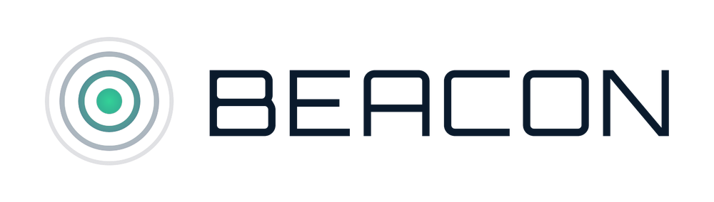
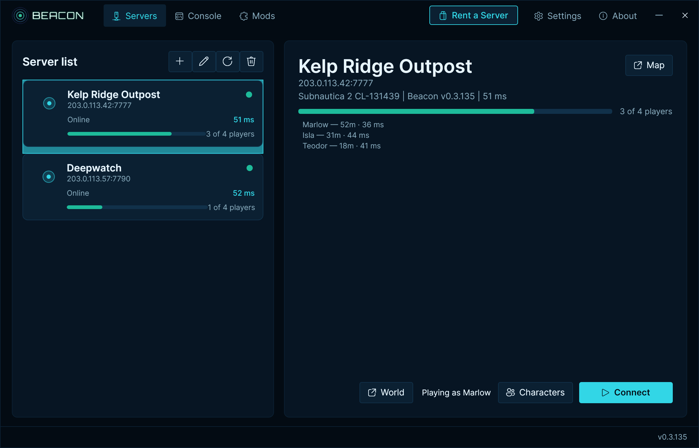
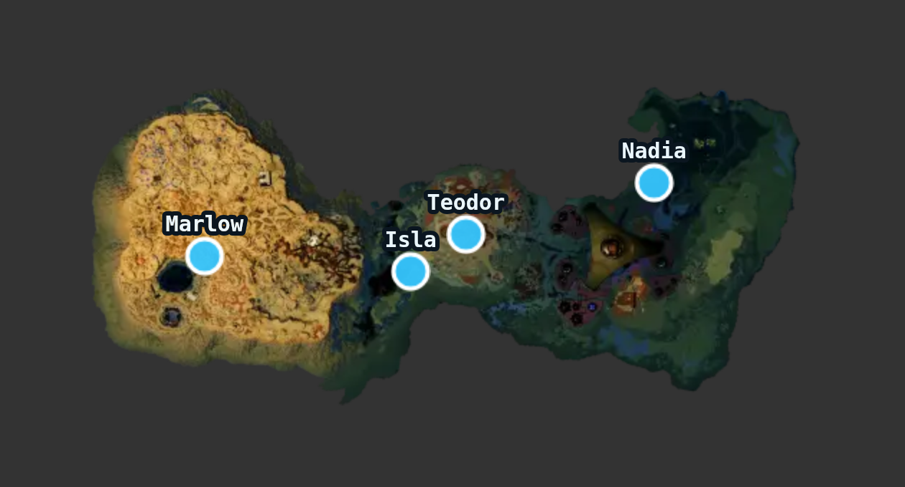
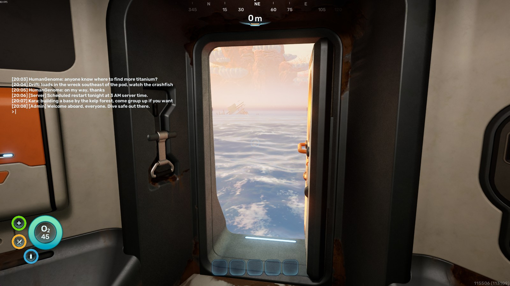
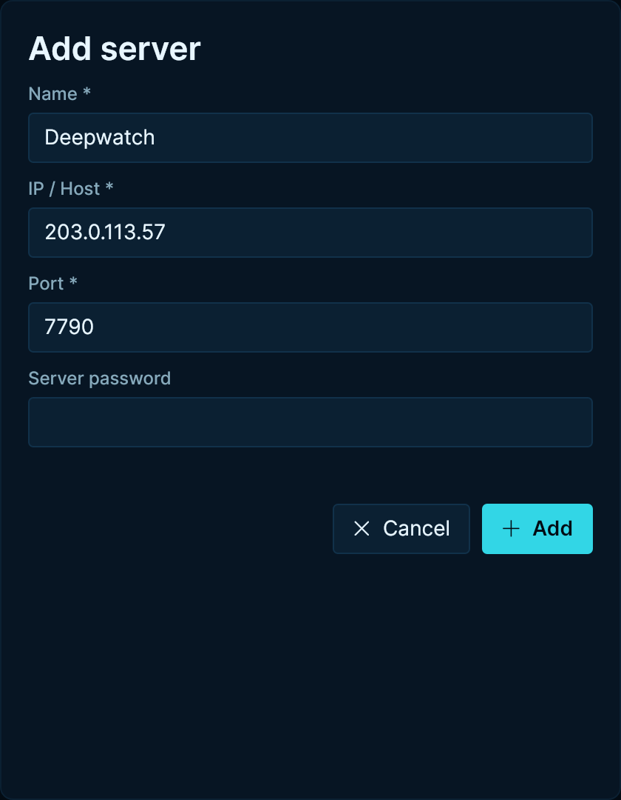
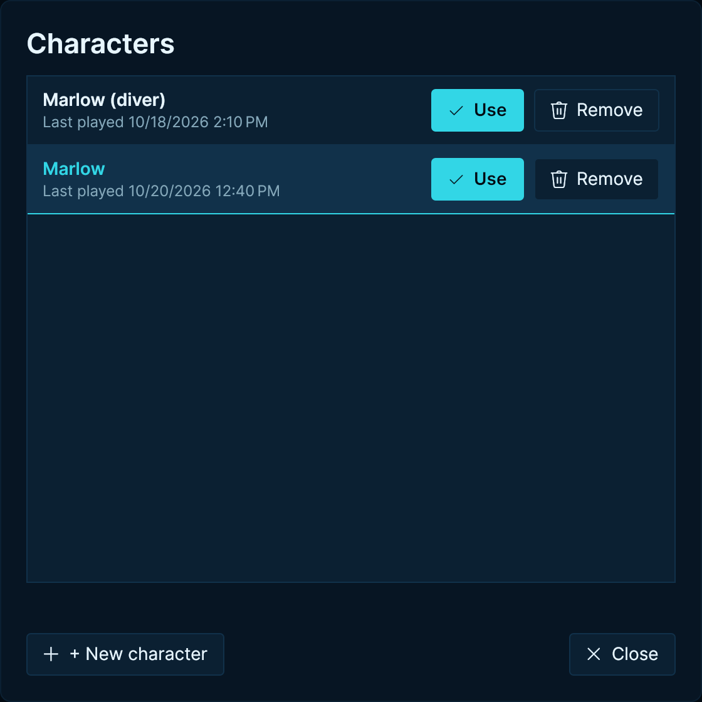
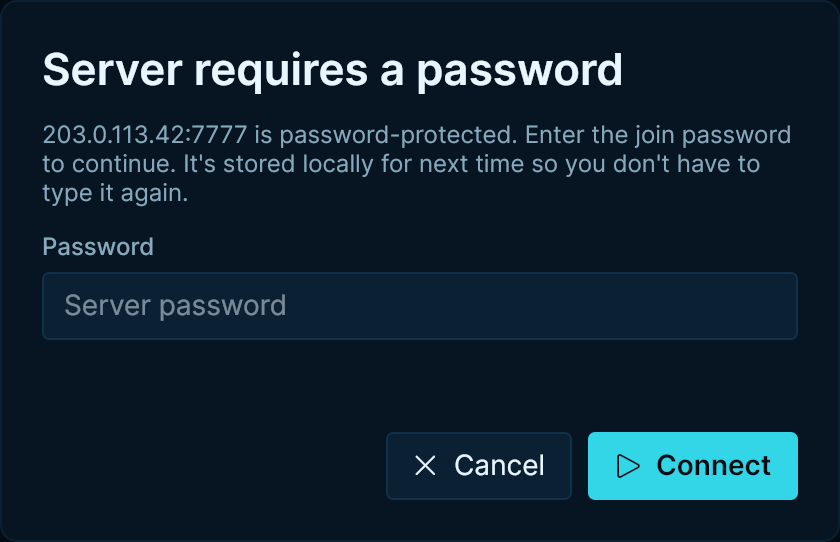
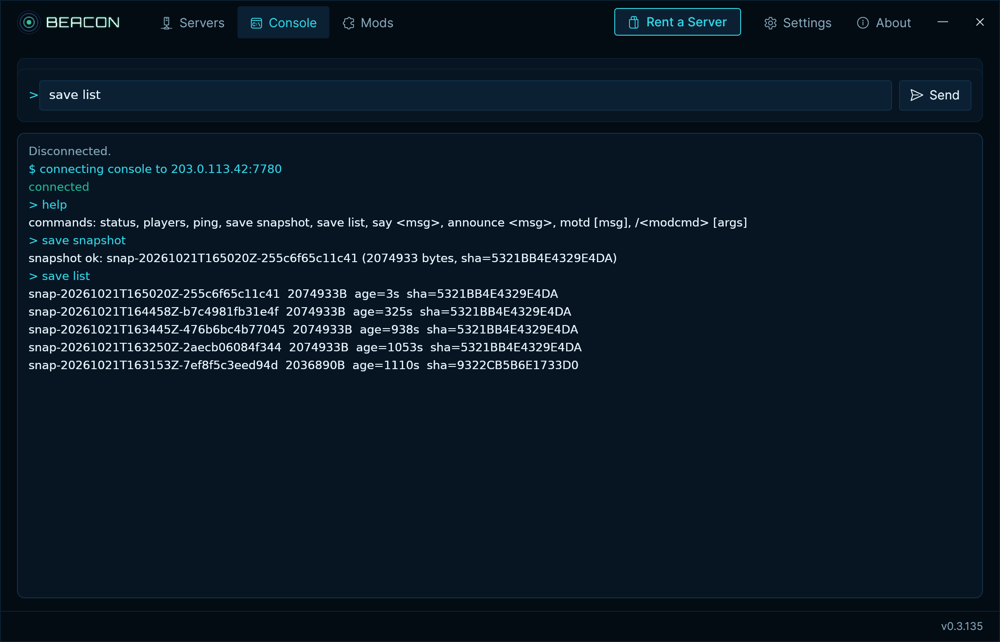
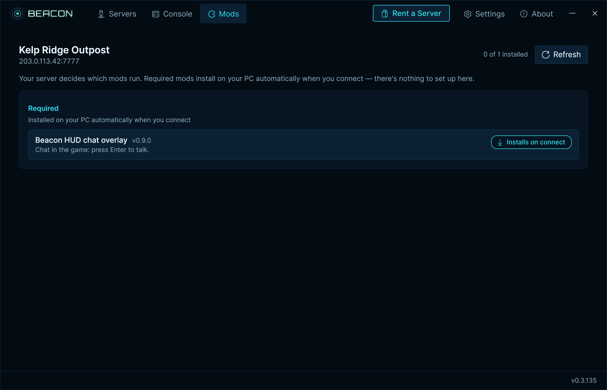

<p align="center">
  <picture>
    <source media="(prefers-color-scheme: dark)" srcset="docs/img/beacon-logo-dark.png">
    
  </picture>
</p>

<p align="center">
  <a href="#install"></a>
  <a href="https://store.steampowered.com/app/1962700/"></a>
  <a href="https://github.com/HumanGenome/BeaconServer"></a>
  <a href="#license"></a>
</p>

# Beacon

**Subnautica 2** has no dedicated server. Its multiplayer is a co-op session of up to four players, hosted from one player's copy of the game. Beacon adds a Subnautica 2 dedicated server: [BeaconServer](https://github.com/HumanGenome/BeaconServer) runs the game headless on a Windows machine with a public IP and port, and the Beacon app connects players to it by address.

Every player must install Beacon to join a Beacon server. Stock Subnautica 2 cannot connect to a Beacon server directly.

<p align="center">
  
</p>

## Features

### 🗺 Live map
See who's online on a real, interactive map of the world. Connected players report their in-world positions, and the launcher's **Map** button opens a browser map that plots each player and updates live, on the full Subnautica 2 world with its points of interest. The map is served from the host's `/map/` page; the live player overlay is visible to anyone the host shares the page with once `Beacon:Map:Public` is enabled in the server settings.

<p align="center">
  
</p>

### 💬 In-game chat
Press Enter to open chat without leaving the game. Beacon overlays a timestamped chat panel in Subnautica 2 with player messages, server notices, and admin announcements. Admins post announcements and a message of the day from the server console, RCON, or the HTTP API, and players can run commands like `/players` and `/help` straight from the chat box. Chat shows in game on servers that offer Beacon's chat overlay; a self-hosted BeaconServer does not include it.

<p align="center">
  
</p>

### 🧭 Join by IP
Add the server's IP or hostname and gameplay port in the app, pick a character and click Connect. The app starts Subnautica 2 with Beacon loaded and joins the server. The server list shows whether each server is up, who is on it and for how long, and your ping.

<p align="center">
  
</p>

### 🧑‍🚀 Multiple characters
Players can keep separate characters per server. Beacon remembers the character you used for each saved server.

<p align="center">
  
</p>

### 🔒 Password protection
Subnautica 2 has no native password handling, so Beacon adds its own. Set `BeaconAuthPassword` in the server's `appsettings.json` and the server gates every remote join on it and kicks anyone who doesn't match. The app asks for the password once and remembers it. The password flag is also reported in Source query, so server browsers show the server as locked.

<p align="center">
  
</p>

### 🔁 Snapshots and rollback
The server snapshots the world on every auto-save, and admins can trigger and list snapshots over RCON:

```
> save snapshot
snapshot ok: snap-20260610T141503Z-7c9e2ab04d113e (52428800 bytes, sha=ab12cd34ef56ab12)
> save list
snap-20260610T141503Z-7c9e2ab04d113e  52428800B  age=42s  sha=ab12cd34ef56ab12
```

The app's **World** window lists the server's snapshots by time and size and downloads any of them. On a self-hosted server, where BeaconServer starts the game, it also restores a snapshot, imports a save from your PC and moves the newest snapshot over from another of your servers, each after a confirmation. The server stops the game, keeps a snapshot of the current world, swaps the world in and starts the game again. There is no restore command over RCON; scripts can use the admin HTTP API (`POST /api/v1/snapshots/<id>/restore`).

<p align="center">
  
</p>

### 🛠 Admin console
BeaconServer exposes Source RCON (default TCP 27018) with built-ins `help`, `status`, `players`, `ping`, `save snapshot`, `save list`, `say`, `announce`, and `motd`, plus slash commands registered by server mods:

```
> announce Server restarts in 10 minutes
chat ok (admin): Server restarts in 10 minutes
```

`announce` posts an admin notice to every connected player's in-game chat overlay. The app's Console tab runs the same commands with the server's admin password:

<p align="center">
  
</p>

### 🧩 Mods
Beacon uses UE4SS for Lua and C++ mod loading on the client and host runtime. Servers declare mods in `appsettings.json` (`Beacon:Mods`); the launcher fetches `GET /api/v1/manifest` on join, verifies each pinned sha256, and installs required mods automatically:

```json
"Mods": {
  "Required": [{
    "Id": "beacon-hud",
    "Name": "Beacon HUD chat overlay",
    "Version": "0.9.0",
    "Url": "https://mods.example.com/beacon-hud-0.9.0.zip",
    "Sha256": "<hex sha256 of the zip>",
    "InstallRoot": "Mods/BeaconHud"
  }]
}
```

The app's Mods tab shows what the selected server requires and installs it when you connect:

<p align="center">
  
</p>

## Install

### Rent a server
The easiest option is a [SurvivalServers.com Subnautica 2 server](https://www.survivalservers.com/services/game_servers/subnautica_2/?utm_source=github&utm_medium=readme_install&utm_campaign=beacon): the complete Beacon server runtime comes preinstalled and the ports are already configured.

### Players
1. Download `BeaconSetup-<version>.exe` from the [latest release](https://github.com/HumanGenome/Beacon/releases/latest).
2. Run the installer. The installer is not code-signed, so Windows SmartScreen may warn; choose **More info** then **Run anyway**.
3. Open Beacon, add the server address, select or create a character, and click **Connect**.

Beacon checks for launcher updates automatically on launch and while it is running. The copy on Nexus Mods (`BeaconSetup-<version>-nexus.exe`) does not update itself; get new versions from its Files tab.

### Self-hosted servers
1. Download `Beacon-Server-Windows-x64-v<version>.zip` from the [latest BeaconServer release](https://github.com/HumanGenome/BeaconServer/releases/latest). It is self-contained: it includes the server (`BeaconServer\`), Beacon's in-game runtime (`ue4ss\` plus the native `Beacon.dll`), and the injector (`tools\`).
2. Extract it to a stable folder, for example `C:\Beacon\`.
3. Install the Subnautica 2 game files under the folder set as `SnInstallRoot` in `BeaconServer\appsettings.json` (default `C:\Beacon\game`): copy your `steamapps\common\Subnautica2` folder there, or install with SteamCMD (app `1962700`). BeaconServer launches the game from that folder; it does not ship the game.
4. Edit `BeaconServer\appsettings.json` (server name, ports, `RconPassword`).
5. Forward/open the gameplay port (UDP), query port (UDP), RCON port (TCP), and admin HTTP port (TCP).
6. Run `BeaconServer\BeaconServer.exe`.

Building the BeaconServer source yourself produces the supervisor only. The in-game runtime is built separately and bundled into the release zip above.

BeaconServer also answers Source A2S query (default UDP 27017), so server browsers, monitoring tools and bots can read its name, map, player count and player list. Full server setup, settings, source query examples, RCON commands, and build instructions live in [HumanGenome/BeaconServer](https://github.com/HumanGenome/BeaconServer).

## Releases

This repo publishes the launcher only:

- `BeaconSetup-<version>.exe`: installer for players
- `BeaconSetup-latest.exe`: stable download URL that always points at the most recent installer
- `BeaconSetup-<version>-nexus.exe`: the same app without self-update, the copy published on Nexus Mods
- `Beacon-Launcher-Windows-x64-v<version>.zip`: portable launcher build
- `checksums-launcher.txt`: hashes for the launcher assets

The dedicated server build (`Beacon-Server-Windows-x64-v<version>.zip`) lives on the [BeaconServer release page](https://github.com/HumanGenome/BeaconServer/releases/latest).

Source archives are generated by GitHub automatically for tags.

## Source

Beacon is split into two repos:

- **Beacon** (this repo): the desktop app players install, plus the public downloads and documentation.
- **[BeaconServer](https://github.com/HumanGenome/BeaconServer)**: the dedicated server hosts run next to Subnautica 2. Open source.

Players only need this repo's releases; hosts run the server from BeaconServer's.

## FAQ

### How do I join a server?
Open Beacon, click Add Server, and enter a name, the server's IP or hostname, and its gameplay port. Add the server password if it has one. Beacon derives the query, RCON, and admin ports from the gameplay port, so you only enter the one port. Select the server, pick or create a character, and click Connect.

### How many players can join?
The host sets the server's slot count (`MaxPlayers` in `appsettings.json`). Subnautica 2's own co-op is built for four players.

### Can I run the server on the same machine I play on?
No. The Beacon server runs its own copy of Subnautica 2 in the background and your game client runs a second copy, and Steam only allows one running instance of a game per account. Run the server on a separate host and connect to it from your gaming PC.

### Do I need to own Subnautica 2 on the server machine?
Yes. BeaconServer launches the real game; it does not ship it. Install the game files under `SnInstallRoot` on the host, from a copy of `steamapps\common\Subnautica2` or through SteamCMD with an account that owns the game.

### Can I import an existing save?
Yes, on a self-hosted server running BeaconServer 0.3.132 or newer. Open the server's **World** window, save its admin password, and use **Choose file & import**. The save must be a `.zip` of a Subnautica 2 SaveGames folder: a `savegame_N.sav` file and the files next to it at the top of the zip, not inside a subfolder. The server keeps a snapshot of the current world first, makes the imported world its `savegame_0.sav` and restarts on it. On a server whose game is started by a hosting panel, the World window offers snapshot downloads only; ask the host to load a save. Before Beacon 0.3.132 the World window showed only its password row.

### Does Beacon change my own Subnautica 2 settings?
Only while you play through Beacon. Connect sets the game's network settings for a Beacon join and a 1600x900 window, in your normal Subnautica 2 config folder. When the game closes, Beacon puts your own Engine.ini and display settings back, or on its next start if the app was closed or crashed by then. A display setting you change in game during the session is kept.

### Is Linux supported?
No. Beacon is Windows-only, for both the player app and the server (Windows 10/11 or Windows Server, 64-bit). The server launches the Windows build of Subnautica 2 and uses Windows process management.

## Known Issues

- **"The game was not started via the platform launcher and will be closed."** Subnautica 2 asks the Steam client to confirm the copy of the game it is running. On a headless host that answer often does not come back, and the game closes itself, which leaves the server relaunching in a loop. Three things have to be true on the server machine: the Steam client is running (offline mode is fine) and signed in to an account that owns Subnautica 2, it is the same Windows user and session that runs BeaconServer, and `steam_appid.txt` containing `1962700` sits next to `Subnautica2-Win64-Shipping.exe`. Beacon writes `steam_appid.txt` for you from v0.3.125 on, so the part left to you is the Steam client.
- **Client and server must be on the same game build.** After a Subnautica 2 update, players on the new build can fail to join an older server, or join and then get disconnected when they reach something the update changed. Update the server's game files whenever the game updates.

## Contributing

Report bugs in this repo's [issues](https://github.com/HumanGenome/Beacon/issues), for the app and the server alike. Include the Beacon and BeaconServer versions, the Subnautica 2 build, and the relevant lines from the server's `logs\beacon-*.log`. Questions about a hosted server go to your hosting provider. Security issues go through [private reporting](https://github.com/HumanGenome/Beacon/security/advisories/new), never a public issue.

## Community Note

Beacon is a community project and is not affiliated with or endorsed by the developers of Subnautica 2.

## License

The documentation in this repo is MIT. The app and in-game runtime binaries attached to releases are free for personal use and closed source. BeaconServer is MIT in its own repo. Full terms in [LICENSE](LICENSE).

## Credits

- [UE4SS](https://github.com/UE4SS-RE/RE-UE4SS): Unreal Engine scripting and modding framework
- [Avalonia](https://avaloniaui.net/): .NET UI framework used by Beacon
- [joric/subnautica](https://github.com/joric/subnautica) (Unlicense): the interactive Subnautica 2 map that powers Beacon's live web map
- [MultiplayerChat](https://www.nexusmods.com/subnautica2/mods/153) by TheMC ([TheMCNetwork](https://github.com/TheMCNetwork/MultiplayerChat)): first showed the approach Beacon's in-game chat uses (typing through UE4SS key binds, holding the player still while typing, and showing chat in the game's own HUD text). Beacon's chat code is its own.
